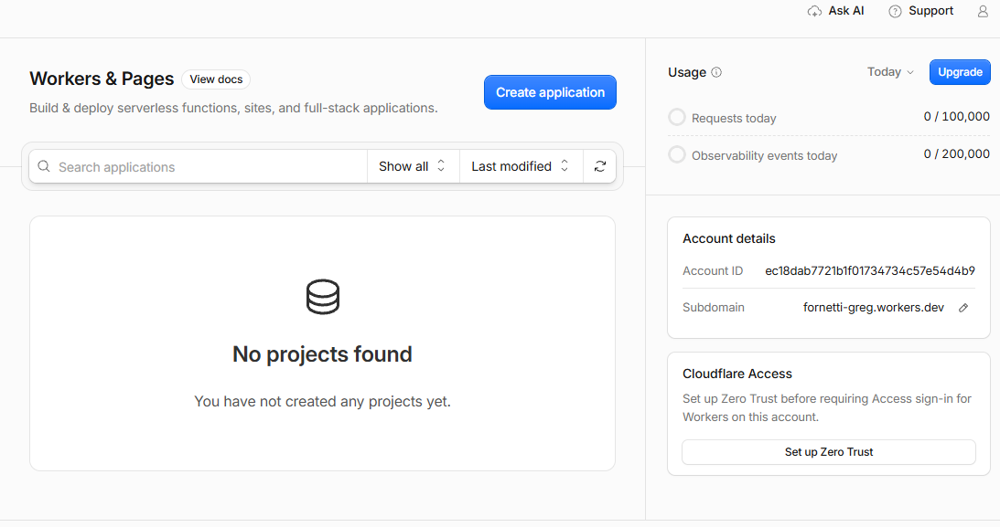
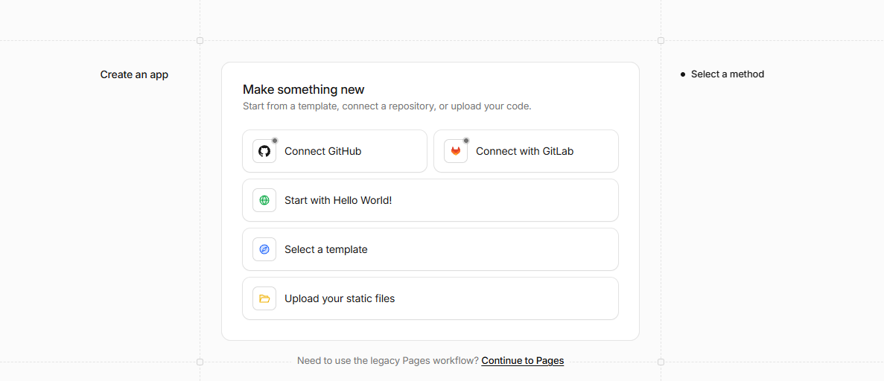
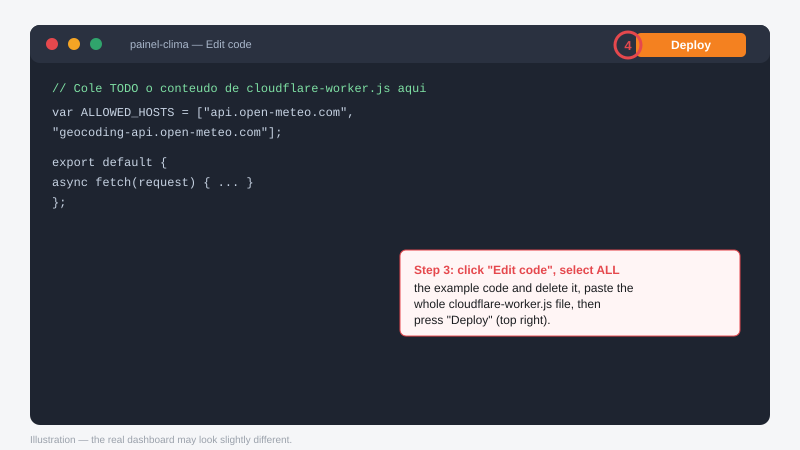
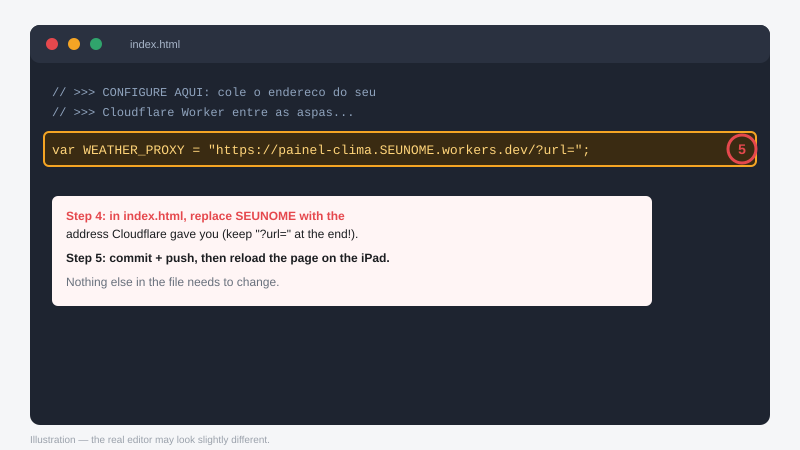

# Painel pessoal

Relógio, calendário e clima em uma única página, feita para funcionar também no Safari antigo do iPad mini (iOS 9.3.5).

## Por que o clima precisa de um proxy?

O iOS 9.3.5 não reconhece o certificado HTTPS do Open-Meteo, e o GitHub Pages (HTTPS) não permite cair para HTTP. A solução é um Cloudflare Worker gratuito que busca o clima no lugar do iPad — o certificado do `workers.dev` é reconhecido pelo iOS 9.

## Instalação do proxy (uma vez, ~5 minutos)

### Passo 1 — Abra "Workers & Pages" e clique em "Create application"



### Passo 2 — Clique em "Start with Hello World!", nomeie `painel-clima` e Deploy



Não use "Upload your static files" — é ele que mostra o erro *"This uploader does not yet support projects that require a build process"*. O Worker não usa upload. Ele começa com um exemplo "Hello World" — é assim mesmo.

### Passo 3 — "Edit code": apague o exemplo, cole o `cloudflare-worker.js` inteiro e Deploy



Teste rápido: abra no navegador de qualquer aparelho
`https://painel-clima.SEUNOME.workers.dev/?url=https%3A%2F%2Fapi.open-meteo.com%2Fv1%2Fforecast%3Flatitude%3D-23.55%26longitude%3D-46.63%26current%3Dtemperature_2m`
Se aparecer um JSON com temperatura, funcionou.

### Passo 4 — Confira a linha `WEATHER_PROXY` do `index.html` e faça commit + push

O `index.html` já está configurado para `https://painel-clima.fornetti-greg.workers.dev/?url=` — por isso o Worker **precisa se chamar exatamente `painel-clima`** no passo 2. Se você der outro nome, ajuste essa linha.



Depois recarregue a página no iPad.

### Alternativa por terminal (em vez dos passos 1–3)

Com o [Node.js](https://nodejs.org) instalado, dentro da pasta do repositório:

```
npx wrangler login
npx wrangler deploy
```

O arquivo `wrangler.toml` já aponta para o Worker certo. Depois faça o passo 4.

## Se o app da tela inicial mostrar uma versão antiga

O app da tela inicial guarda um cache separado do Safari e pode ficar preso numa versão velha. Para forçar a atualização:

1. Faça commit e push da versão nova.
2. No iPad, apague o ícone do painel da tela inicial (toque e segure → apagar).
3. Ajustes → Safari → "Limpar Histórico e Dados dos Sites".
4. Abra a página no Safari, confirme que o clima funciona, e adicione à tela inicial de novo.

A partir daí, a página se atualiza sozinha: ao mudar o número `PAGE_VERSION` no `index.html` e publicar, o app recarrega uma vez com a versão nova.

## Segurança do link público

O endereço do Worker fica visível no código, mas o Worker só aceita buscar dados do Open-Meteo (lista de hosts permitidos no código; qualquer outro host recebe `403`). O pior abuso possível é gastar a cota gratuita diária (100 mil requisições) — sem custo, apenas o clima para até o dia seguinte. Mantenha o Worker no plano gratuito.

## Tela cheia no iPad

No Safari do iPad: botão **Compartilhar** → **Adicionar à Tela de Início**. Ao abrir pelo ícone, o painel roda em tela cheia, sem as barras do Safari.
